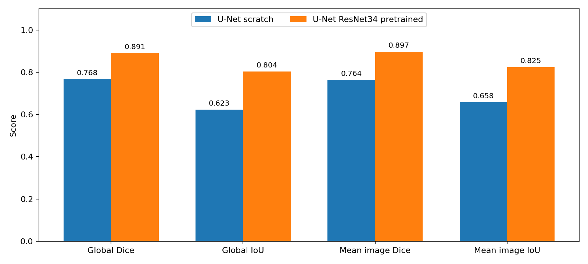

# Thí nghiệm U-Net trên Kvasir-SEG

Hai notebook `Unet.ipynb` và `Unet_ResNet34.ipynb` chứa phần huấn luyện,
đánh giá test và phân tích từng ảnh. Khi đưa vào repo, đặt chúng trong
`notebooks/`. Phần hỗ trợ sau huấn luyện được giữ gọn như sau:

```text
scripts/compare_experiments.py       # tạo bảng, biểu đồ và kiểm tra CSV gốc
report/results/experiments.json     # cấu hình, kết quả và nguồn số liệu của hai run
report/results/comparison.csv       # bảng kết quả tổng hợp
report/results/comparison.png       # biểu đồ so sánh
report/results/unet_kvasir/          # hình train, các ảnh tốt/xấu
report/results/unet_resnet34_kvasir/ # hình train, các ảnh tốt/xấu
docs/unet_error_analysis.md          # nhận xét điều kiện đúng/sai và giả thuyết nguyên nhân
```

## 1. Kết quả và cấu hình đã chạy

| Chỉ số test | U-Net từ đầu | U-Net ResNet34 pretrained |
|---|---:|---:|
| Global Dice | 0.7680 | 0.8912 |
| Global IoU | 0.6233 | 0.8038 |
| Mean per-image Dice | 0.7636 | 0.8968 |
| Mean per-image IoU | 0.6580 | 0.8246 |
| Best epoch | 32 | 20 |
| Epoch đã chạy | 42 | 30 |
| Số tham số | 31,031,745 | 24,348,449 |
| Tổng thời gian epoch trong log | khoảng 58 phút | khoảng 13.4 phút |



Cả hai dùng ảnh RGB 256×256, batch size 2, 2 workers, seed 42, Adam với
learning rate ban đầu 1e-4, loss 0.5 BCE + 0.5 soft Dice. Scheduler là
ReduceLROnPlateau theo validation Dice, factor 0.5, patience 4. Budget tối đa
50 epoch; early stopping patience 10; checkpoint được chọn bằng validation
global Dice cao nhất. Ngưỡng dự đoán 0.5. Không dùng augmentation hoặc AMP.

Ảnh được resize bằng PIL bilinear, mask bằng nearest rồi nhị phân hóa
ở ngưỡng >=128. U-Net dùng ảnh `[0,1]`; ResNet34 dùng chuẩn hóa ImageNet
và trọng số `ResNet34_Weights.IMAGENET1K_V1` từ torchvision, fine-tune toàn
bộ encoder. Cấu hình chi tiết từng run nằm ở khóa `run_config` trong
[`experiments.json`](../report/results/experiments.json), không cần file YAML riêng.

Đây là so sánh hai cấu hình có encoder, decoder và chuẩn hóa khác nhau ở
một seed, chưa tách riêng ảnh hưởng của pretraining. Thời gian là tổng log
epoch trên Tesla T4, không bao gồm chuẩn bị dữ liệu hoặc benchmark suy luận.

## 2. Chia tập và phạm vi số liệu

Notebook chia 80/20, rồi chia phần giữ lại 50/50, cả hai lần seed 42:
800 train, 100 validation, 100 test. Cách này khác giao thức FCBFormer của
pipeline trong repo. Dùng đúng ID của hai notebook khi so sánh.

`data/splits/kvasir_seg_notebook/` chứa bản tái tạo theo thứ tự manifest
local; năm ID test đầu khớp output của cả hai notebook. Trạng thái tái tạo
và mã SHA-256 manifest nằm ở khóa `split` trong `experiments.json`. Chưa
đối chiếu đầy đủ ID gốc trên Kaggle. Các split FCBFormer cũ được giữ nguyên.

Mỗi run trong `experiments.json` có các phần:

| Khóa | Nội dung |
|---|---|
| `run_config` | cấu hình, số tham số và môi trường quan sát được |
| `test_metrics` | kết quả test gộp pixel |
| `test_analysis_summary` | metric gộp và metric trung bình từng ảnh |
| `training_history` | các epoch trích từ log, làm tròn theo số đã in |
| `test_by_size`, `test_by_border` | bảng phân nhóm, điểm làm tròn 4 chữ số |
| `test_error_frequency` | số ảnh theo tiêu chí đúng/sai |
| `test_per_image_preview` | chỉ 5 dòng đã hiển thị, không phải đủ 100 ảnh |
| `provenance` | SHA-256 notebook nguồn, độ chính xác số liệu, trạng thái kiểm tra |

Chưa có CSV từng ảnh đầy đủ hoặc link checkpoint trong bản trích xuất.
Không dùng 5 dòng preview để kết luận số ảnh được cải thiện trên toàn test.
[Phân tích lỗi](unet_error_analysis.md) dùng bảng nhóm và những ví dụ thật
đã hiển thị, đồng thời phân biệt quan sát với giả thuyết nguyên nhân.

## 3. Chạy lại bảng so sánh

Ở thư mục gốc dự án:

```bash
python scripts/compare_experiments.py --plot
```

Script đọc `experiments.json`, tạo `comparison.csv` và `comparison.png`.
Chỉ cần matplotlib khi vẽ; bỏ `--plot` để chỉ tạo CSV bằng thư viện chuẩn.
Không train lại và không cần ảnh dataset cho lệnh này.

Khi có hai thư mục kết quả gốc tải từ Kaggle:

```bash
python scripts/compare_experiments.py --unet-dir outputs/unet_kvasir --resnet34-dir outputs/unet_resnet34_kvasir --plot
```

Mỗi thư mục cần `split_manifest.csv` và `test_per_image.csv` đủ 100 ảnh.
Script kiểm tra đủ ID train/validation/test, số lượng 800/100/100, ID kết quả
trùng tập test, diện tích mask thật và điểm trung bình khớp snapshot. Khi đạt,
script tạo thêm `paired_image_comparison.csv`; `delta_dice > 0` nghĩa là
ResNet34 tốt hơn ở ảnh đó. Các file gốc và checkpoint để trong `outputs/`
đã được bỏ qua trong Git, không cần thêm nhiều bản sao vào thư mục kết quả.

## 4. Lấy split và môi trường từ Kaggle

Các notebook đã tạo CSV metric, lịch sử, bảng lỗi và hình. Thêm cell sau
phần phân tích của mỗi notebook nếu chưa lưu split và môi trường:

```python
import subprocess
import sys
from zipfile import ZipFile, ZIP_DEFLATED

split_output = pd.concat([
    train_df.assign(split="train"),
    val_df.assign(split="validation"),
    test_df.assign(split="test"),
], ignore_index=True)
assert split_output["name"].is_unique
assert split_output["split"].value_counts().to_dict() == {
    "train": 800, "validation": 100, "test": 100,
}
split_output[["name", "split"]].to_csv(
    OUTPUT_DIR / "split_manifest.csv", index=False
)
freeze = subprocess.run(
    [sys.executable, "-m", "pip", "freeze"],
    check=True, capture_output=True, text=True,
)
(OUTPUT_DIR / "environment.txt").write_text(freeze.stdout, encoding="utf-8")

archive = OUTPUT_DIR.parent / f"{OUTPUT_DIR.name}_results.zip"
with ZipFile(archive, "w", compression=ZIP_DEFLATED) as z:
    for path in sorted(OUTPUT_DIR.iterdir()):
        if path.is_file() and path.suffix.lower() in {".csv", ".json", ".png", ".txt"}:
            z.write(path, arcname=path.name)
print("Kết quả nhỏ:", archive)
print("Checkpoint tải riêng:", BEST_MODEL_PATH)
```

Giải nén ZIP vào `outputs/unet_kvasir/` hoặc `outputs/unet_resnet34_kvasir/`.
Đặt checkpoint cùng thư mục hoặc lưu link Kaggle/Drive. Khi có link thật,
ghi vào `provenance.checkpoint_download_url` của run trong `experiments.json`.
Môi trường quan sát hiện tại là Python 3.13.16, PyTorch 2.11.0+cu130, Tesla T4;
các phiên bản thư viện khác cần lấy từ chính Kaggle bằng cell trên.

Hai notebook độc lập dùng NumPy, pandas, matplotlib, Pillow, scikit-learn
và PyTorch/torchvision. Giữ bản PyTorch GPU có sẵn trên Kaggle và chỉ cài
gói còn thiếu. `requirements.txt` ở gốc dành cho cả pipeline của repo.

## 5. Đọc kết quả và viết báo cáo

Các bảng dùng hai cách tổng hợp: global Dice/IoU gộp tổng pixel; mean
per-image Dice/IoU tính từng ảnh rồi lấy trung bình. So sánh cùng định nghĩa.
Các mốc Dice >=0.8, Dice <0.5, Precision/Recall <0.5 là tiêu chí mô tả lỗi.
Diện tích polyp là tỷ lệ pixel, không phải kích thước vật lý. Tập test này
không có nhóm dưới 1%; không mở rộng kết luận sang nhóm đó.

[Phân tích điều kiện đúng và sai](unet_error_analysis.md) giải thích riêng
từng mô hình bằng số liệu và hình minh họa, có cả trường hợp ResNet34 kém
hơn U-Net. Các lỗi test dùng để báo cáo; tinh chỉnh mô hình dựa trên validation.
Ghi nguồn encoder torchvision, phần nhóm tự cài và khai báo những phần AI
đã hỗ trợ thực tế trong báo cáo.
