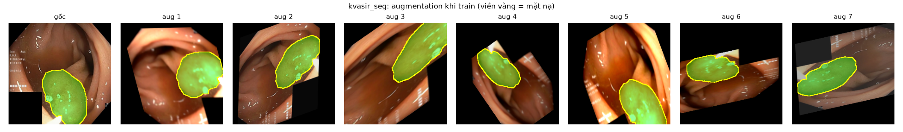
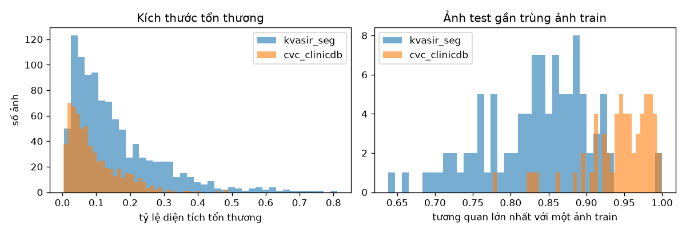
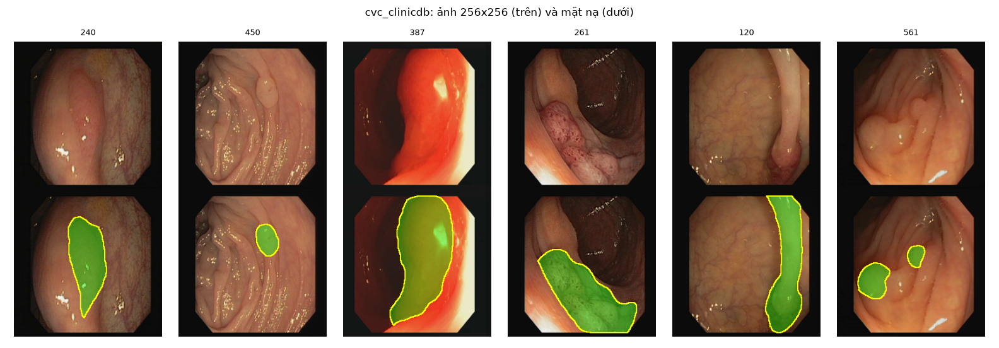

# Báo cáo: Pipeline dữ liệu

Phần việc: chuẩn bị dữ liệu dùng chung cho cả nhóm — tải, chuẩn hóa, resize 256 x 256, augmentation và file chia tập cố định theo paper nền FCBFormer (Sanderson & Matuszewski, MIUA 2022).

## 1. Kế hoạch và trạng thái

| # | Việc | Trạng thái |
|---|---|---|
| 1 | Dựng cấu trúc repo chuẩn (`configs/`, `data/`, `src/`, `scripts/`, `tests/`, `docs/`, `report/`), đường dẫn tính từ gốc repo | Xong |
| 2 | Môi trường `.venv` + `requirements.txt` + cài package `medseg` | Xong |
| 3 | Tải Kvasir-SEG và CVC-ClinicDB, kiểm tra SHA-256, giải nén | Xong |
| 4 | Chuẩn hóa: đọc ảnh/mặt nạ, nhị phân hóa, resize 256 x 256, lưu PNG, ghi manifest | Xong |
| 5 | File chia tập theo giao thức FCBFormer (80/10/10, `random_state=42`) | Xong |
| 6 | Dataset/DataLoader + augmentation theo FCBFormer + chuẩn hóa ImageNet | Xong |
| 7 | Kiểm tra dữ liệu, thống kê, hình minh họa; 19 test pytest | Xong, 19/19 đạt |
| 8 | ISIC 2018 và PH2 | Hoãn theo quyết định của nhóm (xem mục 8) |

## 2. Cấu trúc repo

```
image_segmentation/
├── configs/
│   ├── datasets.yaml        # URL, SHA-256, đường dẫn thô, giao thức chia tập
│   └── data.yaml            # kích thước ảnh, ngưỡng mặt nạ, chuẩn hóa, augmentation, loader
├── data/
│   ├── raw/                 # dữ liệu gốc + file nén (không lên Git)
│   ├── processed/<ds>/256/  # images/*.png, masks/*.png (không lên Git)
│   ├── splits/<ds>/         # train.txt, val.txt, test.txt, all.txt (có trên Git)
│   └── metadata/            # <ds>_manifest.csv: nguồn gốc, kích thước, SHA-256 từng mẫu
├── src/medseg/
│   ├── paths.py             # ROOT của repo, mọi đường dẫn tính từ đây
│   ├── config.py
│   └── data/                # io.py, splits.py, transforms.py, dataset.py
├── scripts/                 # download_data, prepare_data, make_splits, check_data
├── tests/                   # test_data_pipeline.py, test_dataloader.py
├── docs/data_pipeline.md    # hướng dẫn dùng cho cả nhóm
└── report/                  # báo cáo này, figures/, tables/
```

## 3. Dữ liệu

| | Kvasir-SEG | CVC-ClinicDB |
|---|---|---|
| Nội dung | polyp nội soi đại tràng | polyp nội soi đại tràng, khung hình trích từ video |
| Số cặp ảnh/mặt nạ | 1000 | 612 |
| Định dạng ảnh | JPG | TIFF |
| Kích thước gốc | không cố định: rộng 332–1920 px (trung vị 621), cao 352–1072 px (trung vị 530) | cố định 384 x 288 |
| Định dạng mặt nạ | JPG 3 kênh, có nhiễu nén | TIFF xám, nhiều mức xám ở đường biên |
| Nguồn | datasets.simula.no | link Dropbox trong README của FCBFormer |
| SHA-256 file nén | `03b30e21…f7` | `79b8105a…3f` |

SHA-256 đầy đủ nằm trong `configs/datasets.yaml`; `download_data.py` từ chối dữ liệu nếu mã băm không khớp. Mỗi mẫu được ghi lại trong manifest kèm SHA-256 của ảnh và mặt nạ gốc, nên có thể truy ngược mọi file đã xử lý về file gốc.

## 4. Chuẩn hóa

| Bước | Quyết định | Lý do |
|---|---|---|
| Đọc ảnh | JPG/PNG bằng OpenCV, TIFF bằng `tifffile`, chuyển về RGB uint8 | TIFF của CVC khai báo sai kiểu màu (xem 7.1) |
| Nhị phân hóa mặt nạ | pixel > 127 là tổn thương, lấy kênh lớn nhất nếu có 3 kênh | mặt nạ JPG của Kvasir và biên mặt nạ CVC có nhiều mức xám |
| Resize | 256 x 256, không giữ tỷ lệ; ảnh dùng `INTER_AREA`, mặt nạ dùng `INTER_AREA` rồi ngưỡng 0.5 | giống cách FCBFormer resize thẳng (họ dùng 352); `INTER_AREA` tránh răng cưa khi thu nhỏ |
| Lưu | PNG không nén mất dữ liệu; mặt nạ giá trị {0, 255} | không thêm nhiễu nén lần hai |

Đổi kích thước chỉ cần `python scripts/prepare_data.py --size 352`; dữ liệu nằm ở `data/processed/<ds>/352/` và không ghi đè bản 256.

## 5. Chia tập

Tái tạo hàm `split_ids()` trong `Data/dataloaders.py` của FCBFormer: sắp xếp file ảnh theo tên, gọi `train_test_split(test_size=round(0.1 n), random_state=42)` lấy tập test, lặp lại trên phần còn lại để lấy tập val.

| Bộ | train | val | test | all |
|---|---|---|---|---|
| Kvasir-SEG | 800 | 100 | 100 | 1000 |
| CVC-ClinicDB | 490 | 61 | 61 | 612 |

Kiểm tra tự động: các tập không chồng lấn, hợp lại đúng bằng `all.txt`, không có tên trùng, chia tập tất định (chạy lại ra đúng kết quả). `all.txt` dùng cho thí nghiệm chuyển miền.

## 6. Augmentation và chuẩn hóa giá trị pixel

Preset `fcbformer` (chỉ cho tập train), bám theo code FCBFormer:

| Phép biến đổi | Tham số | Áp dụng |
|---|---|---|
| GaussianBlur | kernel 25, sigma 0.001–2 | ảnh |
| ColorJitter | sáng 0.4, tương phản 0.5, bão hòa 0.25, sắc độ 0.01 | ảnh |
| Lật ngang, lật dọc | xác suất 0.5 | ảnh + mặt nạ |
| Affine | xoay ±180°, tịnh tiến ±12.5%, co giãn 0.5–1.5, cắt xiên ±22.5°, viền đen | ảnh + mặt nạ (nearest) |

Chuẩn hóa mặc định theo ImageNet (encoder ResNet34 và MiT của SegFormer đều pretrained trên ImageNet); chế độ `fcbformer` (mean = std = 0.5) có sẵn khi cần tái tạo đúng paper.



## 7. Kiểm tra và phát hiện

### 7.1. Lỗi đọc TIFF của CVC-ClinicDB (đã sửa)

File TIFF của CVC khai báo `photometric = MINISBLACK` (ảnh xám) nhưng chứa 3 kênh. OpenCV đọc ra mảng một kênh (288, 384), nên toàn bộ ảnh CVC lần xử lý đầu bị **mất màu** mà không báo lỗi, chỉ có cảnh báo. `tifffile` đọc đúng (288, 384, 3); kênh 0 có trung bình cao nhất (đỏ), đúng với ảnh nội soi, nên thứ tự là RGB. Pipeline đã chuyển sang `tifffile` cho TIFF và có test `test_cvc_tiff_read_as_color` để lỗi không quay lại.

### 7.2. Thống kê theo tập

Tỷ lệ diện tích tổn thương (theo ảnh gốc). "Nhỏ" là tổn thương dưới 5% diện tích ảnh; "nhiều tổn thương" là mặt nạ có hơn một vùng liên thông.

| Bộ | Tập | n | Trung bình | Trung vị | Min | Max | % nhỏ | % nhiều tổn thương |
|---|---|---|---|---|---|---|---|---|
| Kvasir-SEG | train | 800 | 0.151 | 0.114 | 0.005 | 0.763 | 19.9 | 17.6 |
| Kvasir-SEG | val | 100 | 0.164 | 0.112 | 0.014 | 0.812 | 17.0 | 21.0 |
| Kvasir-SEG | test | 100 | 0.163 | 0.117 | 0.005 | 0.719 | 24.0 | 18.0 |
| CVC-ClinicDB | train | 490 | 0.092 | 0.071 | 0.003 | 0.485 | 36.9 | 9.6 |
| CVC-ClinicDB | val | 61 | 0.095 | 0.062 | 0.009 | 0.490 | 41.0 | 1.6 |
| CVC-ClinicDB | test | 61 | 0.085 | 0.065 | 0.010 | 0.318 | 37.7 | 8.2 |

Nhận xét:
- Polyp trong CVC-ClinicDB nhỏ hơn rõ rệt: trung vị 6.8% diện tích ảnh so với 11.4% ở Kvasir-SEG, và 37% số ảnh có tổn thương nhỏ (Kvasir: 20%). Đây là một nguồn khó khi chuyển miền từ Kvasir sang CVC.
- Phân bố giữa train/val/test trong cùng một bộ tương đối đồng đều; tập val của CVC gần như không có ảnh nhiều tổn thương (1/61), nên chỉ số trên val CVC có thể lệch.

Toàn bộ số liệu: `report/tables/split_stats.csv`, `report/tables/image_sizes.csv`.



### 7.3. Rò rỉ giữa train và test của CVC-ClinicDB

CVC-ClinicDB gồm các khung hình trích từ video nội soi, nên các khung liên tiếp gần như giống nhau. Cách chia ngẫu nhiên của FCBFormer không tách theo video. Để đo mức gần trùng, mỗi ảnh test được so với mọi ảnh train bằng tương quan trên ảnh xám thu nhỏ 32 x 32:

| Bộ | Ảnh test | Trung vị tương quan lớn nhất | % ảnh test có ảnh train tương quan ≥ 0.95 | ≥ 0.90 |
|---|---|---|---|---|
| Kvasir-SEG | 100 | 0.846 | 2.0% | 14.0% |
| CVC-ClinicDB | 61 | 0.954 | **54.1%** | **86.9%** |

Hơn một nửa ảnh test của CVC-ClinicDB có một "bản gần như sao chép" trong tập train. Vì vậy, điểm số trên tập test CVC theo giao thức FCBFormer có thể **cao hơn thực tế**, vì mô hình gần như đã thấy ảnh đó. Kvasir-SEG không có vấn đề này ở mức đáng kể.

Hệ quả cho nhóm:
- Vẫn dùng giao thức FCBFormer khi cần so sánh với paper nền.
- Kết quả train và test trên CVC cần kèm cảnh báo này trong báo cáo cuối.
- Thí nghiệm chuyển miền (train Kvasir, test toàn bộ CVC qua `all.txt`) **không** bị ảnh hưởng, vì hai bộ đến từ hai nguồn khác nhau. Đây thêm một lý do để coi chuyển miền là thước đo đáng tin hơn.



### 7.4. Tái lập và hiệu năng của DataLoader

- albumentations 2.x không dùng seed toàn cục. Repo tự seed bộ biến đổi của từng worker từ seed của DataLoader: cùng seed thì ra cùng batch, các worker khác nhau không bị trùng augmentation (đã kiểm tra bằng test).
- Bật `persistent_workers` để worker không khởi động lại mỗi epoch. Đo trên MacBook (CPU), một epoch train Kvasir-SEG (800 ảnh): 2.4s với 0 worker, 1.3s với 2 worker, 0.7s với 4 worker (không tính epoch đầu). Trước khi bật, 4 worker mất 24s mỗi epoch trên macOS do phải khởi động lại.

### 7.5. Kết quả kiểm thử

`pytest -q`: **19/19 đạt**, gồm: kích thước và tính tất định của cách chia tập, không chồng lấn giữa các tập, nhị phân hóa mặt nạ JPG có nhiễu, resize giữ mặt nạ nhị phân, đọc TIFF có màu, định dạng tensor đầu ra, biến đổi ở tập test là tất định, DataLoader tái lập được với nhiều worker, loader đánh giá không bỏ mẫu nào.

## 8. Hạn chế và việc tiếp theo

1. **ISIC 2018 và PH2 chưa tải.** Máy chủ ISIC chỉ đạt khoảng 0.1–0.2 MB/s, mà ảnh train và test nặng khoảng 13.5 GB (ước tính hơn 15 giờ). Phương án đã khảo sát: bản sao trên Hugging Face (`surajbijjahalli/ISIC2018`, đủ 2594/100/1000 ảnh kèm mặt nạ) tải nhanh hơn nhiều, nhưng không có mã ảnh gốc. Có thể tải các file mặt nạ chính thức (khoảng 37 MB) từ ISIC để so khớp từng mặt nạ, vừa khôi phục tên file vừa xác minh bản sao. Link Dropbox chính thức của PH2 hiện không trả về file. Khi thêm, chỉ cần bổ sung một mục trong `configs/datasets.yaml` và một nhánh giao thức chia tập.
2. **Chưa đối chiếu trực tiếp với code FCBFormer.** Hàm chia tập được viết lại theo đúng từng bước của `split_ids()` (cùng tham số và thứ tự gọi), và số lượng 800/100/100, 490/61/61 khớp với paper. Nhưng chưa chạy chính code của họ để so từng tên file.
3. **Chia tập theo video cho CVC-ClinicDB.** Để có tập test CVC không rò rỉ, cần bảng ánh xạ khung hình sang 31 video gốc rồi chia theo video. Đề xuất làm sau nếu nhóm cần kết quả train/test trong CVC đáng tin.
4. **Một số ảnh Kvasir-SEG có ô hiển thị của máy nội soi** (ô đen hoặc xanh ở góc dưới bên trái, chữ chú thích). Hiện giữ nguyên như paper nền; khi phân tích lỗi nên để ý mô hình có bị ô này đánh lừa không.

## 9. Tái lập

```bash
python -m venv .venv && source .venv/bin/activate
pip install -r requirements.txt && pip install -e .
python scripts/download_data.py
python scripts/prepare_data.py
python scripts/make_splits.py
python scripts/check_data.py
pytest -q
```
